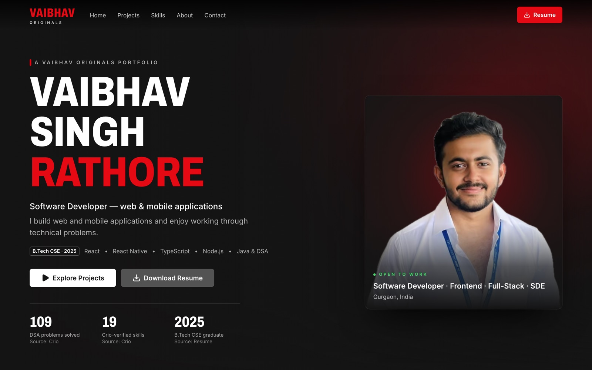
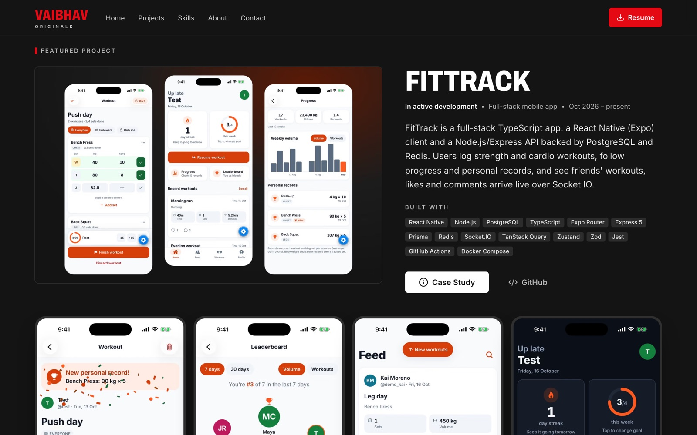
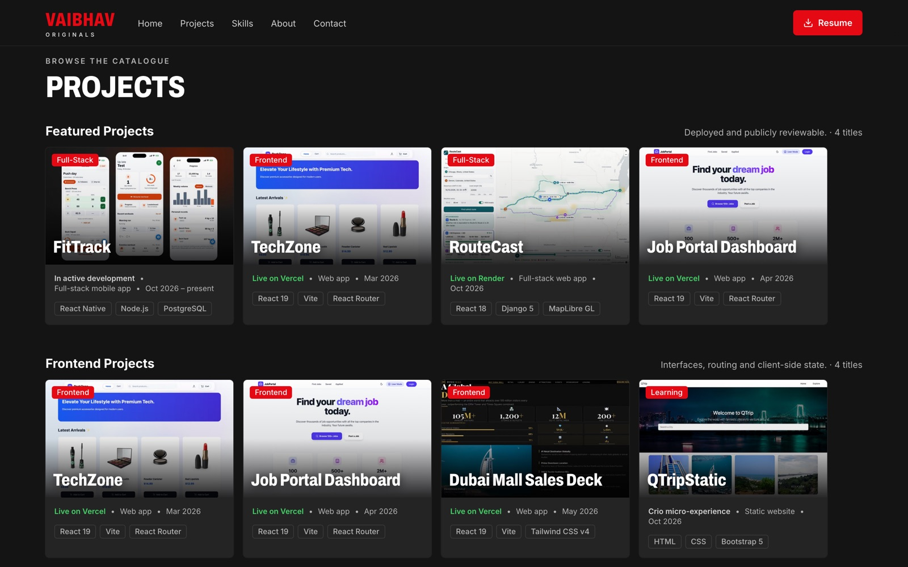
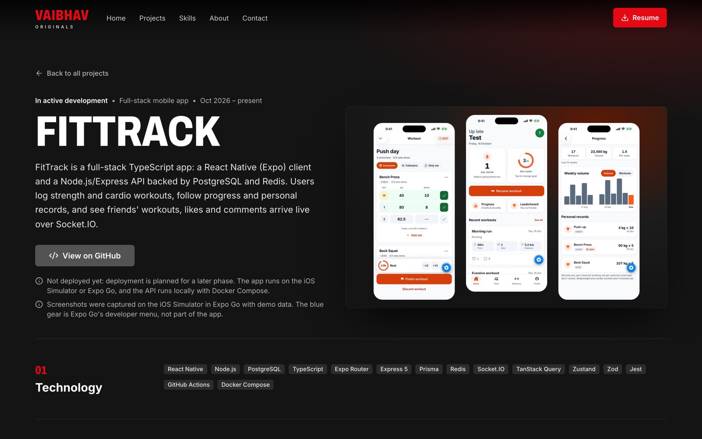
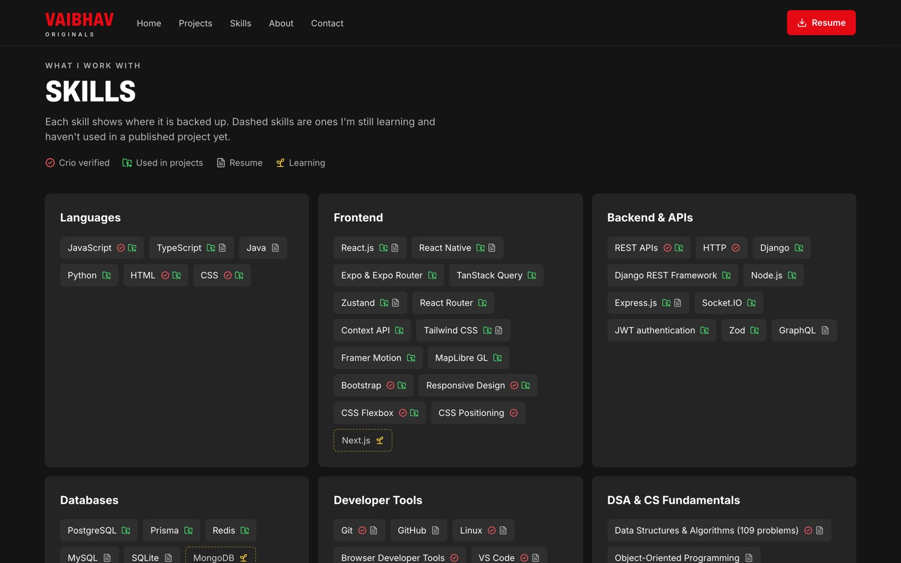
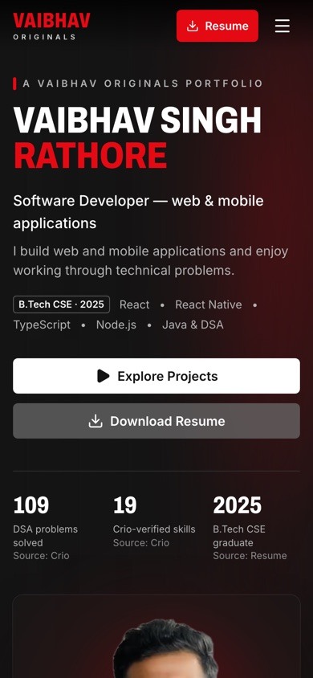
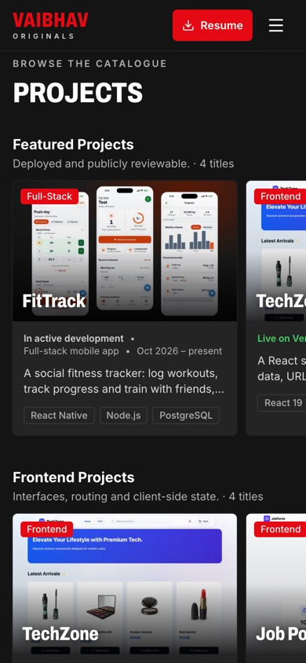

<div align="center">

# VAIBHAV ORIGINALS

**The developer portfolio of Vaibhav Singh Rathore — presented like a streaming catalogue.**

Software Developer · Web & Mobile Applications · B.Tech CSE 2025

### [🔴 View the live site →](https://portfolio-vsr4661s-projects.vercel.app/)

[GitHub](https://github.com/Vsr4661) · [LinkedIn](https://www.linkedin.com/in/vaibhav-singh-r-09ab28237/) · [Crio Portfolio](https://www.crio.do/learn/portfolio/vsr4661/) · [Resume (PDF)](https://portfolio-vsr4661s-projects.vercel.app/resume/Vaibhav_Singh_Rathore_Resume.pdf)

</div>

[](https://portfolio-vsr4661s-projects.vercel.app/)

---

## About

VAIBHAV ORIGINALS is a cinematic, dark-themed portfolio inspired by the way streaming services make a catalogue easy to browse. Projects appear as poster cards in horizontal rows, each opening a full case study — while the things recruiters need (resume, contact details, skills) stay one click away.

**Live:** https://portfolio-vsr4661s-projects.vercel.app/ — deployed on Vercel from the `main` branch.

Every claim on the site is verified: project features are taken from each repository's source code, test counts from CI runs, and profile numbers from the Crio portfolio record. Screenshots are real captures of the actual apps.

## Screenshots

| Featured project | Project catalogue |
|---|---|
|  |  |
| **Case study** | **Skills** |
|  |  |

<p align="center">
  
  &nbsp;&nbsp;
  
</p>

## Featured work

Project names open the case study on the live site; *code* opens the repository.

| Project | What it is | Stack |
|---|---|---|
| [**FitTrack**](https://portfolio-vsr4661s-projects.vercel.app/projects/fittrack) ([code](https://github.com/Vsr4661/fittrack)) | Social fitness tracker with real-time updates (in development) | React Native, Expo, Node.js, Express, PostgreSQL, Prisma, Redis, Socket.IO |
| [**RouteCast**](https://portfolio-vsr4661s-projects.vercel.app/projects/routecast) ([code](https://github.com/Vsr4661/weather-aware-truck-routing)) | Picks the safest truck route from forecast weather, load and travel time | React, TypeScript, MapLibre GL, Django REST Framework, Docker |
| [**TechZone**](https://portfolio-vsr4661s-projects.vercel.app/projects/techzone) ([code](https://github.com/Vsr4661/Ecommerce_store)) | E-commerce storefront with URL search and a persistent cart | React, Vite, React Router, Tailwind CSS, Context API |
| [**Job Portal Dashboard**](https://portfolio-vsr4661s-projects.vercel.app/projects/job-portal) ([code](https://github.com/Vsr4661/job_portal_dashboard)) | Two-role job board: candidates apply, admins manage listings | React, Tailwind CSS, Context API |
| [**Dubai Mall Sales Deck**](https://portfolio-vsr4661s-projects.vercel.app/projects/dubai-mall-deck) ([code](https://github.com/Vsr4661/dubai-mall-deck)) | Interactive sales-deck concept (interview assignment) | React, Tailwind CSS, Framer Motion |
| [**Instagram Clone**](https://portfolio-vsr4661s-projects.vercel.app/projects/instagram-clone) ([code](https://github.com/Vsr4661/Instagram-clone-)) | Feed, stories, reels and chat screens | React Native, Expo |
| [**QTripStatic**](https://portfolio-vsr4661s-projects.vercel.app/projects/qtripstatic) ([code](https://github.com/Vsr4661/qtrip-static)) | Responsive travel site (Crio micro-experience) | HTML, CSS, Bootstrap |

## Features

- **Streaming-style catalogue** — poster cards in swipeable rows, generated from data; empty categories never render
- **Case study for every project** — purpose, features, screens, architecture, challenges and solutions, next steps
- **Recruiter-first** — resume download in the navbar, hero and footer; email, LinkedIn and GitHub always reachable
- **Honest by design** — skills are labelled *Crio verified*, *Used in projects*, *Resume* or *Learning*; missing demos and screenshots are stated, never faked
- **Accessible** — semantic HTML, skip link, visible focus states, keyboard-equivalent hover panels, WCAG AA contrast, `prefers-reduced-motion` support
- **Responsive** — tested from 320 px to 1920 px with no horizontal overflow
- **SEO-ready** — per-page metadata, generated Open Graph image, sitemap, robots, and real `404`s for unknown routes

## Tech stack

| | |
|---|---|
| Framework | Next.js 16 (App Router, Cache Components) · React 19 |
| Language | TypeScript (strict) |
| Styling | Tailwind CSS v4 with design tokens |
| Motion | Motion for React (`LazyMotion`, reduced-motion aware) |
| Icons | Lucide React |
| Images & fonts | `next/image` (AVIF/WebP), `next/font` (Inter, Archivo) |
| Hosting | Vercel |

**Lighthouse (production build):** Accessibility 100 · Best Practices 100 · SEO 100 · Performance 99–100 desktop / 90–93 mobile.

## Project structure

```
app/
  page.tsx                  Home: hero, featured project, catalogue, skills, about, contact
  projects/[slug]/page.tsx  Case-study pages, statically generated from data
  layout.tsx                Fonts, metadata, navbar, footer
  opengraph-image.tsx, sitemap.ts, robots.ts, not-found.tsx, error.tsx
components/
  home/      Hero, featured project, project cards and rows
  project/   Case-study sections and screenshot gallery
  sections/  Skills, About, Contact
  layout/    Navbar, footer, wordmark
  ui/        Buttons, tags, reveal animation, motion provider
data/
  projects.ts   Every project, category and case study (single source of truth)
  profile.ts    Profile, experience and skills
lib/            Types and helpers
proxy.ts        Returns a real 404 for unknown project slugs
public/         Project screenshots, portrait, resume PDF
```

## Run locally

Requires Node.js 20.9 or later.

```bash
npm install
npm run dev          # http://localhost:3000

npm run lint
npx tsc --noEmit
npm run build && npm start
```

## Editing content

All content lives in typed data files; cards, rows and case studies are generated from them.

| What | Where |
|---|---|
| Projects, categories, case-study text, screenshots | `data/projects.ts` |
| Profile, about text, experience, skills | `data/profile.ts` |
| Project screenshots | `public/projects/<slug>/` |
| Portrait | `public/profile/` |
| Resume | `public/resume/Vaibhav_Singh_Rathore_Resume.pdf` |

- A category row appears only when at least one project lists that category.
- The first project in the `featured` category becomes the featured project on the home page.
- New slugs work automatically: static generation, the sitemap and `proxy.ts` all read `data/projects.ts`.
- Each project's `missing` list appears only in `npm run dev`, as an "Owner notes" box on its case study.

## Deploy

Deployed on **Vercel** at https://portfolio-vsr4661s-projects.vercel.app/. Every push to `main` redeploys automatically. No environment variables are required.

To deploy your own copy:

1. In Vercel, choose **Add New → Project** and import this repository.
2. Keep the detected Next.js defaults and deploy.
3. In **Settings → Deployment Protection**, turn off Vercel Authentication if you want the `*-projects.vercel.app` address to be public.

Canonical URLs, Open Graph URLs and the sitemap use the address in `lib/site.ts`. To use a custom domain, set `NEXT_PUBLIC_SITE_URL=https://your-domain` in the project's environment variables (or change `productionUrl`).

---

<div align="center">

© Vaibhav Singh Rathore · An independent portfolio, not affiliated with any streaming service.

</div>
